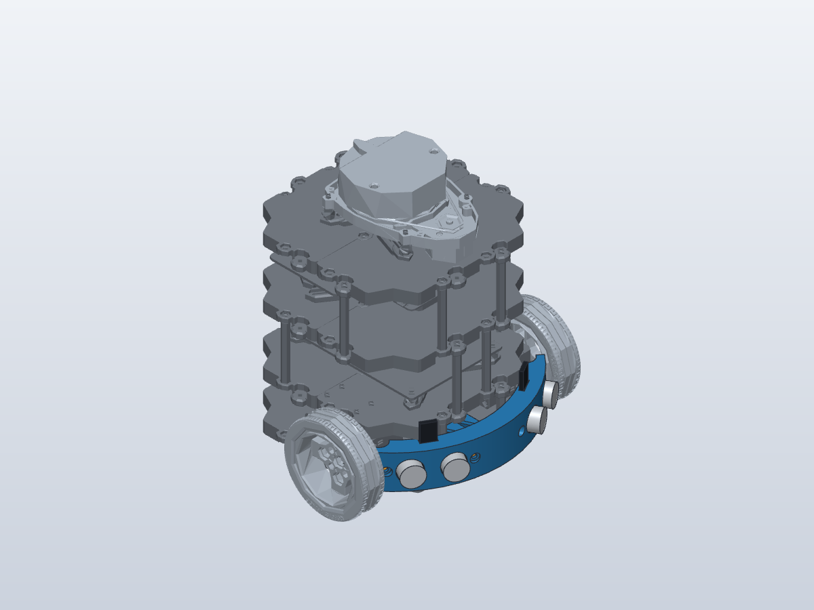

# burgerchan

TurtleBot3 Burgerの実験・開発用リポジトリ。
Raspberry Pi 4向けのROS 2 Humbleセットアップ、RViz設定、超音波センサー用マウントの設計・印刷データをまとめている。



## 目的に応じて使う

| 目的 | ファイル・ディレクトリ |
|---|---|
| Raspberry Piをセットアップする | [setup_sbc.sh](software/scripts/setup_sbc.sh) |
| OpenCRのファームウェアを書き込む | [flash_opencr.sh](software/scripts/flash_opencr.sh) |
| 機体や地図をRVizで表示する | [software/rviz/](software/rviz/) |
| センサーマウントを印刷・変更する | [mechanism/README.md](mechanism/README.md) |
| AIエージェントからSolidCraftを使う | [.agents/skills/](.agents/skills/) |

## Raspberry Pi 4をセットアップする

対象はRaspberry Pi 4、Ubuntu Server 22.04の64bit版、ROS 2 Humble。
以下はPi上で、sudoを使える一般ユーザーとして実行する。

```bash
git clone https://github.com/NOPLAB/burgerchan.git
cd burgerchan
TB3_MODEL=burger LDS_MODEL=LDS-01 ROS_DOMAIN_ID=30 \
  bash software/scripts/setup_sbc.sh
```

スクリプトはROS 2と依存パッケージの導入、`~/turtlebot3_ws` のビルド、
udevルールと `~/.bashrc` の設定を行う。作業先は環境変数 `WS` で変更できる。

OpenCRの書き込みは、USBとバッテリーを接続した状態でPiから実行する。

```bash
OPENCR_MODEL=burger OPENCR_PORT=/dev/ttyACM0 \
  bash software/scripts/flash_opencr.sh
```

## RVizで機体・地図を表示する

ROS 2 HumbleとRVizを導入したPCで、機体と同じ `ROS_DOMAIN_ID` を使う。
機体側のbringupを起動したうえで、リポジトリのルートから実行する。

```bash
source /opt/ros/humble/setup.bash
export ROS_DOMAIN_ID=30
rviz2 -d software/rviz/burger.rviz
```

`burger.rviz` は固定フレームが `odom` で、機体モデル・レーザースキャン・オドメトリを表示する設定。
地図表示には、地図と `map` フレームを配信するSLAMなどを別途起動し、
`rviz2 -d software/rviz/slam.rviz` を使う。このリポジトリにはSLAMの実行パッケージは含めていない。

## 超音波センサーマウントを印刷する

HC-SR04を2個、機体前方の円弧に沿って取り付ける。
印刷する部品は [carrier.stl](mechanism/carrier.stl) を1個、
[clamp.stl](mechanism/clamp.stl) を4個。単位はmm。
編集・受け渡し用の [carrier.step](mechanism/carrier.step) と
[clamp.step](mechanism/clamp.step) も同梱している。

取り付け方、必要なねじ、印刷姿勢、SolidCraft・FreeCADでの再生成手順は
[機構のREADME](mechanism/README.md)を参照。
CAD上の干渉確認は実施済みだが、実機試着・荷重試験は未実施。

## 第三者データの出典

機体モデル・図面の出典とライセンス情報は [mechanism/sources.json](mechanism/sources.json)、
SolidCraftスキルの出典は [.agents/skills/UPSTREAM.md](.agents/skills/UPSTREAM.md) に記録している。
スキルには上流のMIT・Apache-2.0ライセンス文書を同梱している。
